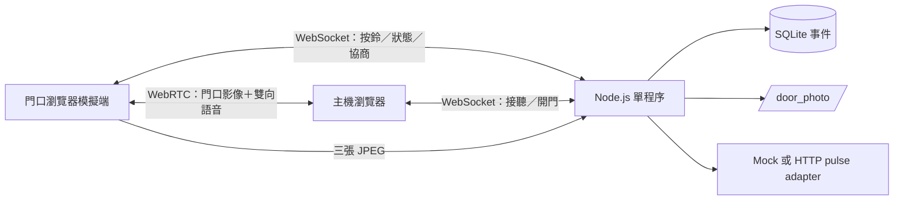

# 架構與硬體建議

## 第一版：先驗證使用流程



此階段不預設設備，不加 Redis、MQTT、微服務、影音辨識、全時錄影或轉碼。單後端擁有唯一通話狀態，SQLite WAL 保存歷程；重啟後不恢復通話、不重播開鎖，`server_started` 記錄重啟界線。僅可執行一份 app，不能以多副本分散記憶體中的通話狀態。

影音目標 720p / 15fps，由瀏覽器協商 WebRTC 共同支援的 codec，不強制 H.265。音訊使用瀏覽器回音消除、降噪及自動增益。實際解析度、AEC 效果與延遲取決於攝影機、瀏覽器、聲學環境和網路，不能由軟體保證。

狀態：`idle → ringing → connected → ended`；`ringing` 也可直接開門或掛斷。無人接聽預設 30 秒，通話上限 180 秒。開門先將此次通話標記終止、廣播停止影音，再發控制命令；同一呼叫 ID 只能進入一次開鎖路徑。此順序不代表已收到兩個瀏覽器的影音釋放確認，若瀏覽器失去回應，伺服器無法遠端保證其媒體裝置已停止。

WebSocket 每 10 秒 heartbeat，死亡連線最慢約兩個週期被清除。瀏覽器 WebRTC failed/disconnected 持續 8 秒就終止會話。連線關閉不自動重連，避免恢復舊通話。若主機在按鈴期間加入，門口會重新送出預覽 offer。

## 以穩定為優先的實體配置

首選 **整合式有線 PoE SIP 影像對講機**：按鈕、攝影機、麥克風、喇叭、AEC 與 relay 出自同一套設備。相較於拼裝 USB 麥克風、USB 喇叭、Pi 攝影機，整合設備可降低聲學與驅動整合風險；此為工程判斷，仍需現場試機。

| 部位 | 建議 | 原因與選型條件 |
| --- | --- | --- |
| 門口機首選 | AXIS I8116-E | 官方文件列有 SIP、PoE、雙向音訊／回音消除、內建 relay；驗證事件通知、JPEG snapshot API 與當地供應／支援 |
| 門口機替代 | 2N IP Solo（含攝影機版本） | SIP 整合門口機；確認當前韌體、所需 HTTP API／功能授權、戶外安裝條件、螢幕需求 |
| 主機 | Intel N100／N150 等級 x86 小主機，8 GB RAM、256 GB SSD、有線 LAN；穩定版 Linux＋Docker Engine | 此為單門控制與事件儲存的起始規格，若加影音轉碼須重新量測；正式運作優先避免 Windows 睡眠／Docker Desktop 人工登入依賴 |
| 接聽設備 | 有線網路電腦＋USB 耳麥 | 耳麥能大幅降低同室聲音回授；主機與接聽電腦可為同一台 |
| 網路與供電 | 有管理功能 PoE switch、Cat6、有線 LAN、UPS | 固定 DHCP 租約；門口機、主機、交換器共用備援電力，避開 Wi-Fi 品質波動 |
| 電鎖控制 | 室內受保護位置的 dry-contact 控制器，具本地限時脈衝與開機預設狀態 | 不讓網頁／容器負責延時斷電；避免外側門口機被拆卸後直接短接開鎖線 |
| 門磁（建議） | 獨立門位感測輸入 | 區分「已送開鎖命令」與「門真的打開」；目前程式沒有此感測回報 |

門口繼電器的接點可用於測試，但正式安裝優先將電鎖電源與控制器放室內。電鎖須使用合適的獨立電源，不假設 PoE 足以驅動任何電鎖。斷電開／斷電關、緊急出門與消防接點須依現場需求及安裝條件決定。

**文字聯絡方式需特別處理**：I8116-E 與 IP Solo 不應視為可顯示任意聯絡文字的螢幕終端。最簡單可靠的配置是在按鈕旁固定標示聯絡電話，或另加小型顯示器；如果要求「只有無人應答才顯示文字」，選有可控制螢幕的門口設備，購買前確認 API。目前門口網頁已可在無人接聽／結束後顯示設定文字。

## 接入 SIP 設備時的最小變更

瀏覽器模擬端可直接 WebRTC；商用 SIP 門口機**不等於原生 WebRTC 設備**，不能保證直接連上目前網頁。選定設備後再加一個 SIP/WebRTC gateway（例如 Asterisk），以設備 SIP 通話接到主機瀏覽器，保留現有後端的狀態、事件、照片和 relay 介面。另一個更簡單的正式方案是用設備支援的 SIP 桌上話機接聽，但會改變目前的瀏覽器接聽體驗。

正式拓撲：門口 SIP 音訊／影像 → SIP/WebRTC gateway → 接聽瀏覽器；設備按鈕事件 → 後端；後端於 0/1/2 秒呼叫設備 JPEG snapshot API → `/door_photo/`；後端 → 室內 relay adapter。需量測早期媒體（接聽前影像）是否受設備支援，若不支援，採獨立按需影像路徑，這部分不能在硬體選定前宣稱已完成。

目前 `iceServers: []` 僅供同機／可直連 LAN。Docker 只承載信令，不承載目前的 WebRTC 影音。跨 VLAN、防火牆或遠端接聽需先實測 ICE；必要時配置 TURN，不能只開放 3900 就假設影音可通。正式 HTTPS 與 SIP gateway 是下一階段，不納入這次的本機原型。

## HTTP relay adapter 契約

`RELAY_MODE=http` 時，後端只向管理員預先設定的 HTTPS `RELAY_URL` POST，不接受瀏覽器傳入設備 URL，也不跟隨 redirect。帶 `Authorization: Bearer RELAY_TOKEN` 和 `Idempotency-Key: <call-id>`。

```json
{"commandId":"<call-id>","pulseMs":3000}
```

回應需為成功狀態與 JSON `{"commandId":"<相同 call-id>","accepted":true}`。控制器必須持久化去重、在本地計時解除 relay，脈衝設定上限 10 秒。若在 4 秒內未取得正確確認，記錄 `relay_unknown`，不自動重送，以免「其實已開門但回應遺失」導致再次開鎖。確認只代表命令已接受，沒有門磁就無法證明門扇已開。

此契約尚未經真實控制器驗證。廠牌 API 需要另外實作 adapter，不直接套用到 Axis 或 2N URL。

## 參考資料（2026-11-11 查核）

- [AXIS I8116-E 官方操作文件](https://help.axis.com/en-us/axis-i8116-e)：SIP、回音消除、relay、網路設定。
- [AXIS I8116-E 官方資料表](https://www.axis.com/dam/public/15/05/67/datasheet-axis-i8116-e-network-video-intercom-en-US-410819.pdf)：音訊功能與 codec。
- [2N IP Solo 官方產品頁](https://www.2n.com/en-US/products/intercoms/2n-ip-solo/) 與 [官方安裝文件](https://wiki.2n.com/download/attachments/59769789/2N_IP_Solo_Installation_Manual_EN_2.18.pdf)。
- [MDN getUserMedia](https://developer.mozilla.org/en-US/docs/Web/API/MediaDevices/getUserMedia)：secure context 與設備權限。

價格、台灣庫存與功能授權未取得經銷商報價；建議借機驗收後採購。
